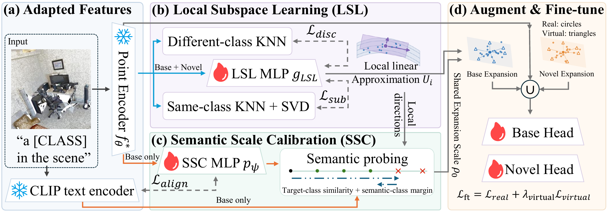
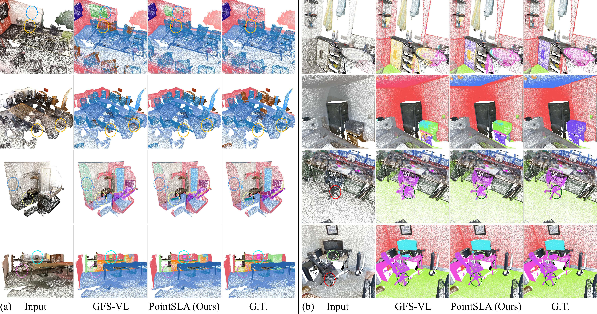

# PointSLA: Subspace Learning and Augmentation with Vision-Language Models for Few-Shot Point Cloud Segmentation

<p align="center">
  <b>Generalized Few-Shot 3D Point Cloud Segmentation</b><br>
  Local Subspace Learning + Semantic Scale Calibration + Virtual Feature Augmentation
</p>

## Overview

PointSLA targets generalized few-shot point cloud segmentation, where a model must learn novel classes from only a few annotated support samples while preserving its ability to segment base classes.

Our key idea is to improve the coverage of sparse novel-class features. PointSLA first learns local intra-class variation directions, then uses frozen vision-language semantics to calibrate how far features can be safely expanded, and finally generates virtual features for few-shot adaptation.

### Main Pipeline

<p align="center">
  <a href="./visilization/results/main_vis.pdf">
    
  </a>
</p>

### Qualitative Results

<p align="center">
  <a href="./visilization/results/results_vis.pdf">
    
  </a>
</p>

The qualitative comparison follows:

```text
Input | GFS-VL Baseline | PointSLA (Ours) | Ground Truth
```

---

## Method

PointSLA contains two main components:

- **Local Subspace Learning (LSL):** learns local intra-class feature variation directions while suppressing inter-class intrusion.
- **Semantic Scale Calibration (SSC):** uses frozen CLIP text semantics to estimate a conservative expansion scale that preserves semantic consistency.

The learned subspace and calibrated scale are then used to synthesize virtual point features for few-shot adaptation.

The current implementation retains several historical `CDC` file/config names for compatibility. In the paper formulation, these modules correspond to **LSL** and **SSC**.

---

## Training Pipeline

The implementation follows three stages:

1. **Base pretraining:** learn transferable local geometry and semantic calibration from Base classes.
2. **Few-shot adaptation:** adapt the task model and local subspace using fixed K-shot Novel support sets.
3. **Virtual feature refinement:** generate subspace-guided virtual Novel features and refine the Novel classifier.

For ScanNet++:

```bash
bash scripts/run_scannetpp_cdc_full_pipeline.sh
```

Equivalent full-pipeline scripts are also provided for ScanNet and ScanNet200.

---

## Results

### ScanNet200

| Setting | Base mIoU | Novel mIoU | All mIoU | HM |
|---|---:|---:|---:|---:|
| 1-shot | 69.16 | 30.30 | 38.48 | 42.13 |
| 5-shot | 68.89 | 32.85 | 40.43 | 44.49 |

### ScanNet++

| Setting | Base mIoU | Novel mIoU | All mIoU | HM |
|---|---:|---:|---:|---:|
| 1-shot | 62.94 | 23.17 | 39.08 | 33.84 |
| 5-shot | 62.05 | 27.43 | 41.28 | 38.03 |

---

## Visualization and Analysis

Point/text feature-space analysis:

```bash
bash scripts/run_scannetpp_point_text_umap.sh
```

Run both UMAP and t-SNE:

```bash
METHOD=both bash scripts/run_scannetpp_point_text_umap.sh
```

Feature-pair export and segmentation visualization utilities are available under:

```text
tools/
visilization/
```

---

## Repository

```bash
git clone https://github.com/DCTyxx/PointSLA.git
cd PointSLA
```

Default branch:

```text
feature/cdc-base-geometry-step1
```

---

## Acknowledgement

PointSLA is developed on top of the original **GFS-VL** implementation and builds upon Pointcept, PTv3, RegionPLC/PLA, OpenScene, and COSeg.

We thank the authors of these projects for their excellent open-source contributions.

Original GFS-VL reference:

```bibtex
@inproceedings{an2025generalized,
  title={Generalized Few-Shot 3D Point Cloud Segmentation with Vision-Language Model},
  author={An, Zhaochong and Sun, Guolei and Liu, Yun and Li, Runjia and Han, Junlin and Konukoglu, Ender and Belongie, Serge},
  booktitle={IEEE/CVF Conference on Computer Vision and Pattern Recognition},
  year={2025}
}
```

## Citation

The PointSLA citation will be added after the paper metadata is finalized.
